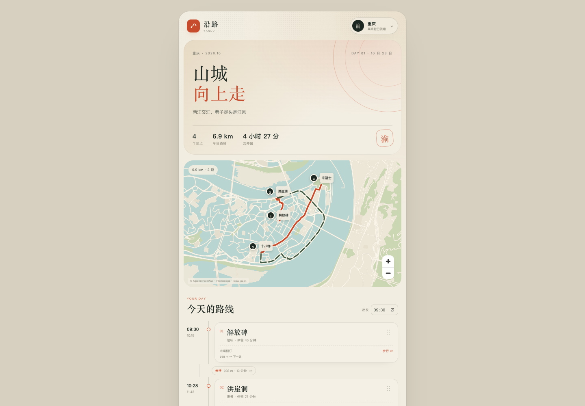
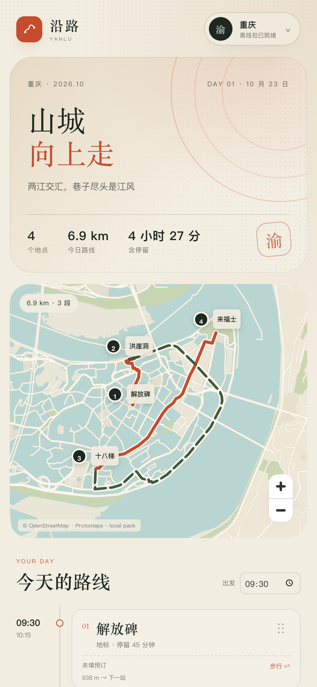
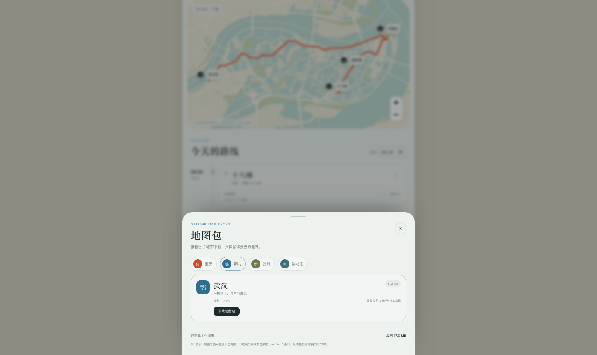
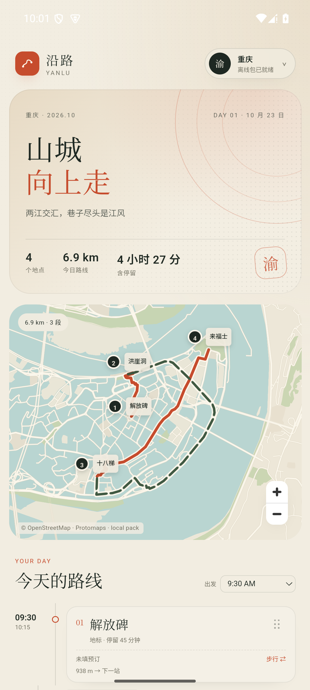
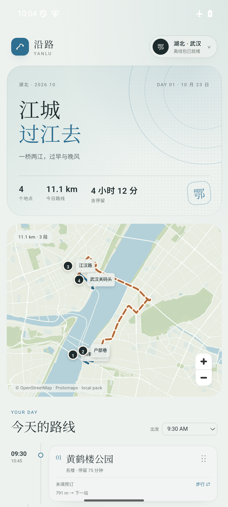

# M1 · 省份/城市地图包 + 单日行程闭环

- 日期：2026-10-23
- 状态：已在 Web + Android 35 arm64 模拟器跑通；物理真机可手动安装 APK
- 代码：[app/](../../app/)、[Android 壳](../../android/README.md)
- 截图：[screenshots](screenshots)

## 目标与结果

M1 把“验证页”换成了可编辑的第一版产品：

1. 用户按省份/城市选择地图包，看到体积、版本、下载状态和已占空间；
2. 下载后可切换城市，整个 App 的背景、标题、印章、地图配色一起变化；
3. 进入单日行程，可添加/删除地点、改停留时间、步行/打车切换、拖动排序；
4. 每次修改后，本地 A* 重算 leg、路线和到达/离开时间；
5. 关闭/刷新/重开，行程和下载状态保留；
6. 飞行模式下仍能加载地图和算路。

## 关键实现

### 包与主题

- `app/src/data/packs.ts` 是包注册表：省份 → 城市 → 主题、体积、可用状态。
- 当前有 4 个省份入口：重庆、湖北、贵州、黑龙江。
- 3 个可下载城市：重庆、武汉、贵阳；哈尔滨是“准备中”占位，用来提前验证黑龙江主题。
- 主题是 CSS 变量：`--paper / --ink / --accent / --water / --hero-a…`，切城市即时变化。
- 下载当前读取每城 `manifest.json + walk.json + car.json`，进度按路网字节计算；底图瓦片在本 M1 中随 App 打包。
- 删除会移除下载状态并切回其他已下载城市；至少保留一个城市包。

### 行程与算路

- `Trip → Day → Stop`，Stop 有坐标、停留、`transportToNext`、预订备注。
- 拖动用 dnd-kit；drop 后只更新数组，`useRouting` 统一重算所有 leg。
- Web Worker 读取 `/packs/<city>/walk.json` 或 `car.json`，按最近节点吸附后跑 A*。
- 地图用 MapLibre，路线按 `walk`/`taxi` 分两层；marker 显示 stop 序号。
- 时间由 `startTime + 停留 + leg duration` 顺序推导；改出发时间/排序/交通方式都会联动。

### 持久化

`localStorage` key：`yanlu.m1.v1`，保存：

- activeCity
- downloaded cities
- 每城 trip（日期、startTime、stops、顺序、transport、booking）

## 验证记录

| 项目 | 结果 |
|---|---|
| Web 首次加载 | 地图、4 个种子点、6.9 km / 4 小时 27 分 |
| 城市包 | 重庆 17.6 MB、武汉 21.2 MB、贵阳 10.1 MB；下载/使用/占用空间正常 |
| 主题 | 重庆暖红、湖北江蓝、贵州苔绿、黑龙江冰蓝；地图/背景/标题同步 |
| 加地点 | 重庆加李子坝后变成 5 点 / 12.6 km / 4 段 |
| 拖动 | 鼠标拖第一张卡到第三位，顺序变化，路线 12.6 → 11.8 km |
| 交通切换 | 3.6 km 打车切步行后变 1.9 km / 27 分钟，路线重算 |
| 删除 | 删除洪崖洞后剩 4 点，路线重算 |
| 持久化 | reload 后城市、5 个点、顺序和路线仍在 |
| Android | 35 arm64 模拟器安装 26 MB APK，页面 0.5 s 完成；冷启动 655 ms；PSS 93.5 MB |
| Android 包管理 | 下载武汉后切到湖北主题、武汉行程、11.1 km 路线 |
| Android 离线 | 飞行模式 + 关闭 Wi-Fi/数据，强停重开仍加载武汉地图和路线 |

## M1 明确没做

- 多日行程、行程列表、真实航班/酒店/门票表单
- 离线 POI 搜索、地图点选、真实地点库
- 远程 pack archive 下载/解压/校验、缓存 eviction
- IndexedDB/数据迁移
- 局域网多人协作
- 完整道路/POI 文字标签
- iOS

## 下一步 M2

1. 离线 POI 索引 + 搜索 + 地图选点；
2. 多日行程和行程列表；
3. 真实 pack archive（PMTiles + graph + POI）下载、校验、删除、版本更新；
4. 预订/票据字段；
5. IndexedDB + 迁移；
6. 然后进入局域网同步。
