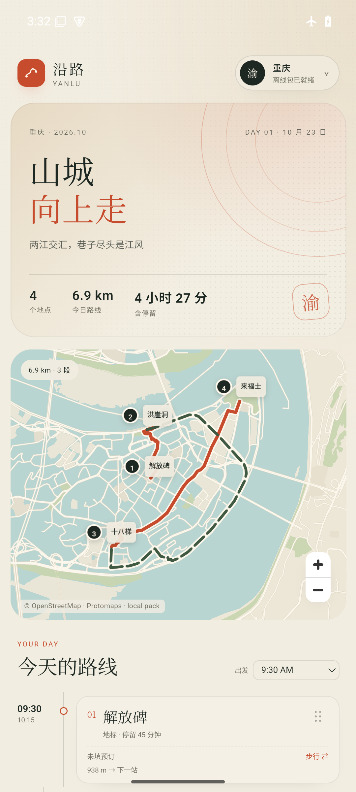

# M2.1 · 真实城市包下载与存储

- 日期：2026-10-23
- 状态：Web + Android 35 arm64 模拟器通过；物理真机待验证
- 目标：把 M1 的“本地演示下载”换成**真实归档下载、解压、本机缓存、删除释放、离线读取**。

## 结果

- 城市包改为独立归档：`<city>.yanlu-pack.zip`
  - 重庆 9.7 MB、武汉 11.4 MB、贵阳 5.7 MB（压缩后）
  - 解压后对应原包 17.6 / 21.2 / 10.1 MB
- App 基座不再内置三城地图包：APK 从 26 MB 降到 **549 KB**
- 下载：
  - `fetch` 归档（带进度）→ `fflate` 解压 → 写入 CacheStorage
  - 每个城市缓存 484 个条目（manifest + walk + car + 481 个 MVT）
- 地图：
  - 从 CacheStorage 读出 MVT，转成 Blob URL，通过 MapLibre `transformRequest` 注入
  - 不再依赖 Service Worker（Android WebView 对 worker 请求拦截不一致）
- 路由：
  - 主线程从 CacheStorage 读取 graph，post 给 Web Worker A*
  - 不再从 App 内置 `/packs` 目录读取
- 删除：
  - App 内自定义确认弹层，不再出现 `http://127.0.0.1` 的 WebView 原生标题
  - `caches.delete('yanlu-pack-<city>')` 真正删除缓存，同时 revoke Blob URL
  - 已下载城市/占用空间同步变化
- 首启：
  - 没有缓存时进入“先下载一座城市”，打开地图包，下载后进入行程

## 验证记录

### Web

1. 清空 CacheStorage / localStorage，进入首启页。
2. 下载重庆归档，缓存 484 条，状态变为“已下载 1 个城市 / 17.6 MB”。
3. 关闭地图包，地图和路线为 6.9 km / 3 段。
4. 停掉 pack server，刷新页面：地图和 6.9 km 路线仍可用（完全从 CacheStorage）。
5. 下载武汉后切到湖北主题（11.1 km），点删除：App 内确认弹层显示城市与体积，不再弹 `127.0.0.1` 标题；确认后：
   - `caches.keys()` 只剩 `yanlu-pack-chongqing`
   - UI 变回 1 个城市 / 17.6 MB / 重庆

### Android 35 arm64 模拟器

1. 安装 549 KB 的 M2 APK，首启进入地图包页。
2. 通过 `10.0.2.2:8090` 从 Mac 的 pack server 下载重庆。
3. 地图 `transformRequest` + Blob URL 显示正常；路线 6.9 km / 3 段。
4. 停掉 pack server，强停重开：地图和 6.9 km 路线仍可用。
5. 下载武汉 → 切换湖北主题 → 11.1 km；删除确认在 App 内完成，确认后缓存只剩重庆。
6. 飞行模式 + 关闭 Wi-Fi/数据，强停重开，地图/6.9 km 路线仍可用。
7. 冷启动/离线截图见下。





## 真实包服务器

真机下载卡在 1% 的排查见 [troubleshooting](troubleshooting/README.md)；不需要科学上网。

本地验证用：

```bash
cd app
python3 scripts/pack_server.py --port 8090
```

- 浏览器：`http://127.0.0.1:8090`
- Android 模拟器：`http://10.0.2.2:8090`
- 物理手机：需要把 `PACK_BASE_URL` 指到 Mac 的局域网 IP 或真实 CDN；当前构建默认只适配模拟器。
- 生产替换为 OSS/COS：`https://<cdn>/packs/<city>.yanlu-pack.zip`。

## 还没做

- 包归档 SHA-256 校验、断点续传、暂停/取消、磁盘配额/淘汰
- 真实 OSS/COS 上传与 CDN
- 省级聚合包（一次下全省）
- 包版本更新/差分
- 离线 POI 搜索、多日行程、局域网同步

中文标注已完成，见 [M2.2a 记录](labels/README.md)。

## 关键文件

- `app/src/lib/packCache.ts`：归档下载、缓存校验、删除
- `app/src/lib/tileStore.ts`：CacheStorage → Blob URL
- `app/src/hooks/useRouting.ts`：从缓存读 graph，交给 worker
- `app/scripts/build_pack_archives.py`：`pack-source` → `.yanlu-pack.zip`
- `app/scripts/pack_server.py`：本地带 CORS 的包服务器
- `app/src/App.tsx`：首启、下载/删除状态、真实存储
