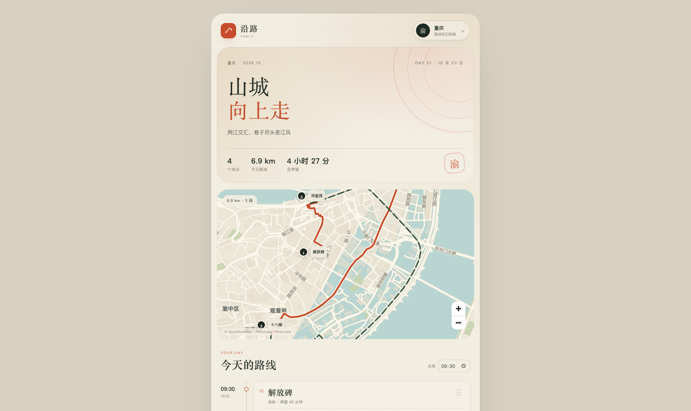
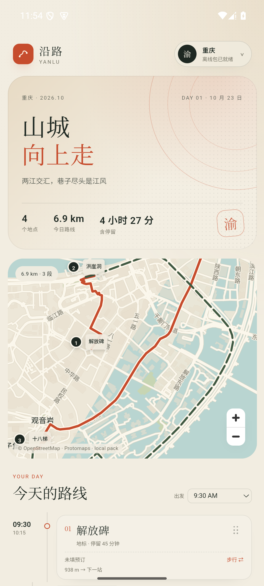
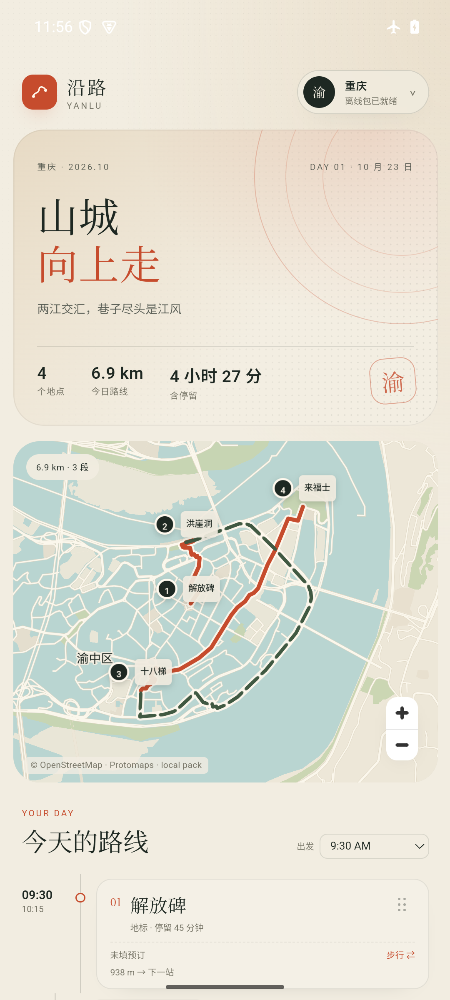

# M2.3a · 可选精细底图（z16）

- 日期：2026-10-23
- 状态：重庆精细包已生成；Web + Android 35 arm64 模拟器下载/使用通过
- 目标：地图包不再只有一档固定精度，用户可以在标准包之外下载更细的底图。

## 结果

当前标准重庆包：

- z0–15，481 个瓦片
- 底图约 6.36 MB，路网约 11.3 MB，zip 9.7 MB

新增重庆精细包：

- z0–16，**1769 个瓦片**
- 其中 z16 新增 **1288 个瓦片**
- 瓦片约 7.65 MB，zip **7.5 MB**
- 复用标准包的 walk/car 路网，不重复下载路网

App 里的表现：

- 标准包下载后，出现“精细底图 · z16”
- 精细包单独下载、单独删除、单独计占用
- 已下载精细包时，地图自动使用精细缓存
- 删除精细包时回到标准 z15，不影响标准包和路线

## 为什么是 z16，不是 z17

当前使用的 Planetiler 0.10.2 最大只允许 `maxzoom=16`，传 17 会直接报：

```text
Max zoom must be <= 16, was 17
```

所以这一版把“精细”定义为 z16。z17 需要更新 Planetiler 或换切片器，后面再做。

另外，**瓦片变细不等于路线变准**：路线仍来自标准包里的 walk/car 图。精细包只改变底图视觉细节。

## 生成方式

用重庆 OSM PBF + Protomaps Planetiler profile 生成 z16 PMTiles：

```text
chongqing-latest.osm.pbf
  + Protomaps basemap profile
  + clip: 106.42,29.49,106.65,29.63
  + maxzoom=16
→ chongqing-fine.pmtiles (5.0 MB)
```

再按 bbox 导出 z16 ZXY 瓦片，叠在标准包 z0–15 上，生成：

```text
pack-source/chongqing-fine/
├── manifest.json
└── tiles/0..16/...
```

打包：

```bash
cd app
python3 scripts/build_pack_archives.py
# chongqing-fine 7.5 MB
```

## 验证

### Web

1. 下载标准重庆包。
2. 地图包底部出现“精细底图 · z16 / 7.7 MB”。
3. 下载精细包，占用从 17.6 MB 变为 25.3 MB。
4. 地图放大到 z16，建筑和道路细节比标准包更细。
5. 删除精细包，占用回到 17.6 MB，地图回退标准 z15。

### Android 35 arm64

1. 安装 637 KB APK，使用已下载的标准重庆包。
2. 在包服务器填 `http://10.0.2.2:8090`（模拟器）后下载精细包。
3. 缓存 `yanlu-pack-chongqing-fine`：1770 条，其中 z16 瓦片 1288 条。
4. 飞行模式 + 关闭 Wi-Fi/数据，强停重开，精细地图、中文标注和 6.9 km 路线仍正常。







## 已知限制

- 只有重庆有精细包；武汉/贵阳还是标准 z15。
- 精细包复用标准包的 walk/car 路网，路线精度不会因为精细底图自动提高。
- z16 相对 z15 只多一级；更高精度需要 z17+ 切片器。
- 精细包目前仍从本地 pack server 下载，不是 CDN。
- 包服务器 IP 会变化；真机在 App 内“包服务器”里改，当前 Mac IP 可用 `ipconfig getifaddr en0` 查。

## 关键文件

- `app/src/data/packs.ts`：`fine` 元数据
- `app/src/lib/packCache.ts`：standard/fine 两套缓存
- `app/src/lib/tileStore.ts`：按 variant 物化 Blob URL
- `app/src/components/MapView.tsx`：精细缓存 + `maxzoom 16`
- `app/src/components/Sheets.tsx`：精细底图下载/删除 UI
- `app/scripts/build_pack_archives.py`：打包 `<city>-fine.yanlu-pack.zip`
