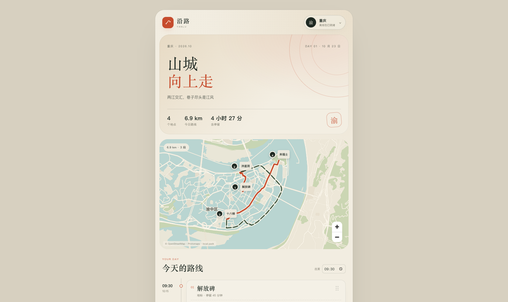
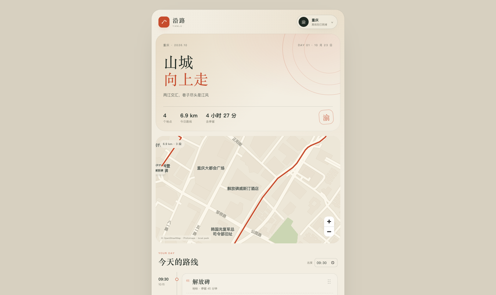
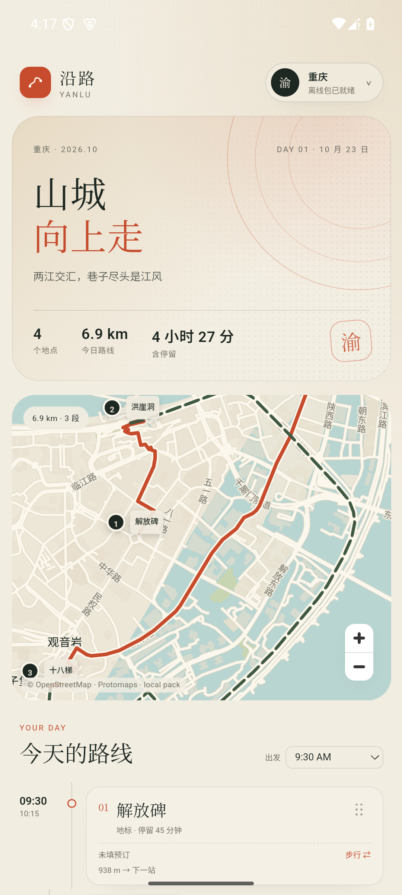
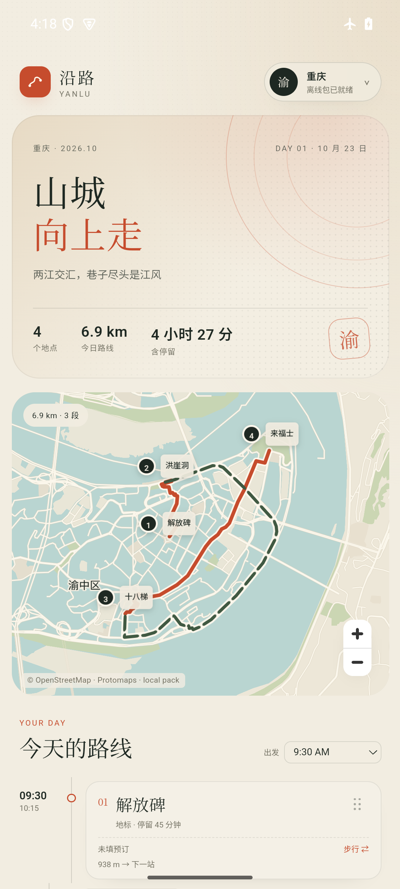

# M2.2a · 本地中文字体与道路/POI 标注

- 日期：2026-10-23
- 状态：Web + Android 35 arm64 模拟器通过；离线可用
- 目标：地图上不再只有行程点，补上中文道路名、地点名和 POI 名。

## 实现

### 本地字体

- `app/public/fonts/NotoSansSC/`
  - `0-255.pbf`：拉丁字母、数字、基础标点
  - `8192-8447.pbf`：常用标点
  - 来自 [protomaps/basemaps-assets](https://github.com/protomaps/basemaps-assets)，Noto Sans OFL
- 中文汉字由 MapLibre `localIdeographFontFamily` 使用设备系统 CJK 字体渲染，不需要下载中文字体
- `glyphs: '/fonts/{fontstack}/{range}.pbf'` 指向 App 本地资源，断网可用
- 字体资源约 137 KB，APK 从 549 KB 增至 **637 KB**

### 标注图层

在 `MapView` 的 MapLibre style 中新增：

- `place-labels`：区/街道/地名；按 `min_zoom` 和 `kind` 过滤
- `road-labels`：主干道/次干道名；`symbol-placement: line`，按缩放级别控制字号
- `poi-labels`：医院、学校、公园、景点、车站、商场、酒店等；按 `min_zoom` 和 `kind` 过滤

文本优先使用：

```js
['coalesce', ['get', 'name:zh-Hans'], ['get', 'name:zh'], ['get', 'name']]
```

配色跟随城市主题：正文用 `theme.ink` / `theme.muted`，描边用 `theme.paper`。

## 验证

### Web

- 初始视图显示“渝中区”等区级中文名
- 放大到 z14–16 显示“八一路、青年路、中华路、邹容路、五一路、新华路”等道路名
- z16 显示“重庆大都会广场、解放碑威斯汀酒店、韩国光复军总司令部旧址”等 POI





### Android 35 arm64

- 初始视图显示“渝中区”
- 放大显示中文道路名
- 飞行模式 + 关闭 Wi-Fi/数据，强停重开：地图、中文标注、6.9 km 路线都正常






## 已知限制

- 没有 POI 图标 sprites，只有文字。
- 低缩放级别只显示少量区级标签；更多道路/POI 需要放大。
- HTML 行程 marker 不参与 MapLibre 的文字碰撞，低缩放时区名可能与 marker 接近。
- 标注密度按当前三城调过，其他城市可能还需要调 `min_zoom`/字号。
- 还没有离线 POI 搜索/地图点选；这是 M2.2b。
- 没有英文/双语标注；当前优先中文。

## 关键文件

- `app/src/components/MapView.tsx`：三个 symbol 图层、glyphs、`localIdeographFontFamily`
- `app/public/fonts/NotoSansSC/`：本地 Latin/标点 glyphs
- `docs/m2/labels/`：本记录与截图
