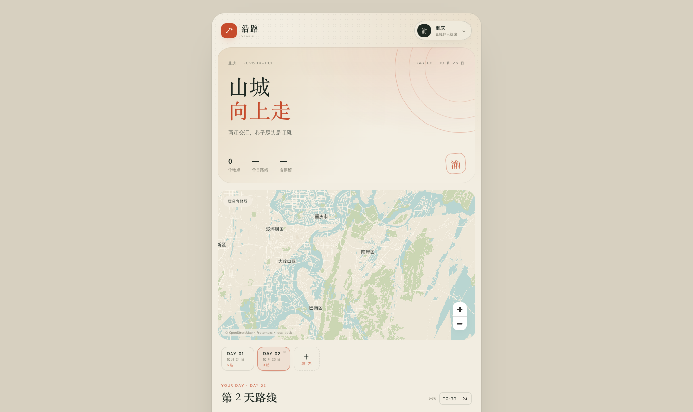
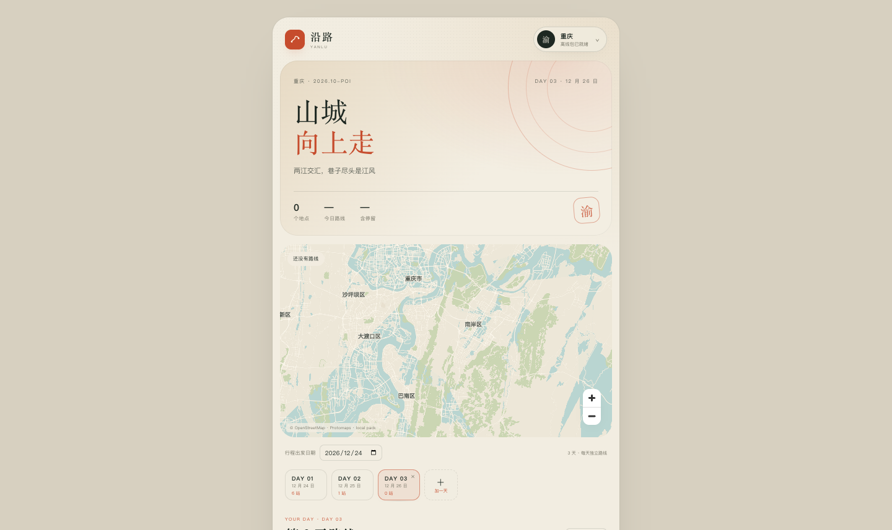

# M2.4 · 多日行程

- 日期：2026-10-24
- 状态：Web 验证通过；Android APK 已构建，真机待验证

## 数据模型

`Trip` 从单日：

```ts
{ day: Day }
```

改成：

```ts
{
  days: Day[];
  activeDayId: string;
}
```

每一天独立保存：

- 日期
- DAY 01 / DAY 02 标签
- 出发时间
- 地点顺序
- 每个地点停留时长、交通方式、预订备注

## 旧存档迁移

启动时 `normalizeTrip()` 会：

- 旧 `trip.day` 自动转成 `days: [day]`
- 设置 `activeDayId`
- 没有 `startDate` 时用第一天日期补上
- 已经有 `days` 的存档直接使用
- 缺失日期/标签/出发时间时补默认值

不需要用户手动清缓存。

## 交互

- 行程顶部可选择**出发日期**；修改后所有天按新日期顺延，支持提前规划
- 地图下方增加 Day 标签栏
- 点击 `DAY 01 / DAY 02` 切换当天
- `＋ 加一天` 自动按上一天日期 +1 创建空白天
- 最后一天显示 `×`，删除前确认
- 每天的添加地点、地图点选、拖拽排序、出发时间、算路都只作用于当前天
- 切换天会重置选中地点，不影响其他天
- 当前天不是第一天时，显示“复制前一天”，把前一天地点复制过来并跳过已存在地点

## 验证

- 旧单日存档加载后自动显示 `DAY 01`，6 个地点保留
- 点“加一天”生成 `DAY 02`，日期自动 +1，地点为 0
- 在 DAY 02 搜索并加入“洪崖洞”，DAY 02 显示 1 站；切回 DAY 01 仍是 6 站
- 把出发日期改为 2026-12-24：DAY 01 变 12/24，DAY 02 变 12/25；再加一天为 12/26
- 在 DAY 03 点“复制前一天”，DAY 03 从 0 站变 1 站
- 刷新页面后两天及各自地点都保留
- 删除 DAY 02 后回到 DAY 01，确认框生效







## 下一步

- 每天独立标题/城市（现在城市仍是全局）
- 单点复制到指定天（现在是整日复制）
- 多日总览/总时长
- 每天独立地图视野
