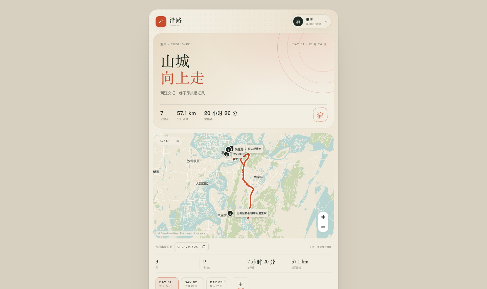
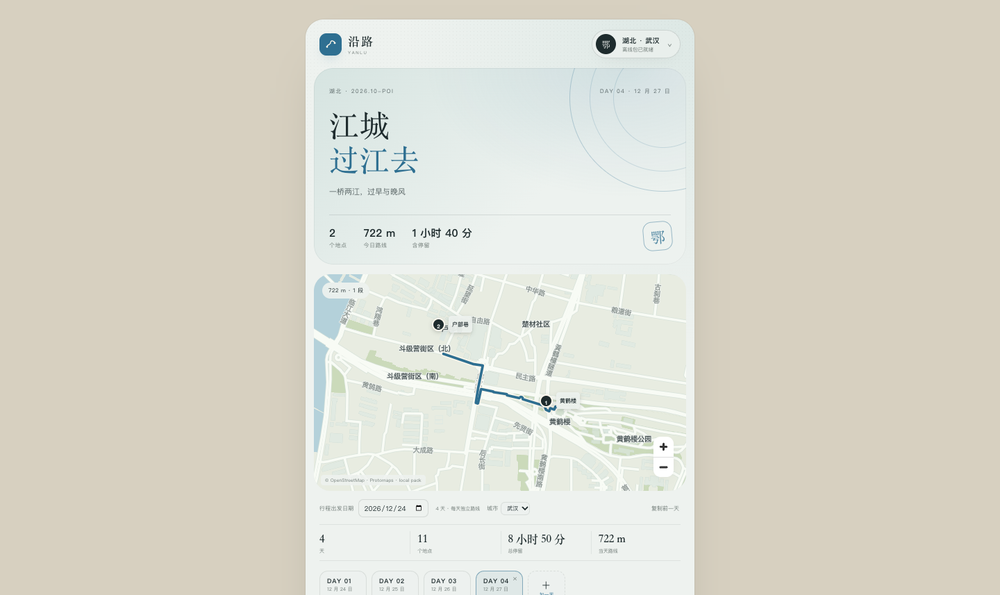

# M2.4 · 多日行程

- 日期：2026-10-24
- 状态：Web 验证通过；Android APK 已构建，真机待验证

## 数据模型

`Trip` 从单日：

```ts
{ day: Day }
```

改成：

```ts
{
  days: Day[];
  activeDayId: string;
}
```

每一天独立保存：

- 日期
- DAY 01 / DAY 02 标签
- 出发时间
- 地点顺序
- 每个地点停留时长、交通方式、预订备注

## 旧存档迁移

启动时 `normalizeTrip()` 会：

- 旧 `trip.day` 自动转成 `days: [day]`
- 设置 `activeDayId`
- 没有 `startDate` 时用第一天日期补上
- 已经有 `days` 的存档直接使用
- 缺失日期/标签/出发时间时补默认值

不需要用户手动清缓存。

## 交互

- 行程顶部可选择**出发日期**；修改后所有天按新日期顺延，支持提前规划
- 地图下方增加 Day 标签栏
- 点击 `DAY 01 / DAY 02` 切换当天
- `＋ 加一天` 自动按上一天日期 +1 创建空白天
- 最后一天显示 `×`，删除前确认
- 每天的添加地点、地图点选、拖拽排序、出发时间、算路都只作用于当前天
- 切换天会重置选中地点，不影响其他天
- 当前天不是第一天时，显示“复制前一天”，把前一天地点复制过来并跳过已存在地点
- 地点编辑面板可把单个地点复制到任意一天
- 地点可设置“固定到达时间”；时间轴会等待这个时间，后续地点自动顺延
- 住宿卡片记录入住/退房与备注，不参与算路

## 逐日算路

- 一个 routing worker 同时为所有天、所有城市算路
- 结果按 dayId 缓存在 `routesByDay`
- 总览、Day 卡片、地图 badge、同行摘要共用同一份逐日结果
- 切换天不会重新算路

## 验证

- 旧单日存档加载后自动显示 `DAY 01`，6 个地点保留
- 点“加一天”生成 `DAY 02`，日期自动 +1，地点为 0
- 在 DAY 02 搜索并加入“洪崖洞”，DAY 02 显示 1 站；切回 DAY 01 仍是 6 站
- 把出发日期改为 2026-12-24：DAY 01 变 12/24，DAY 02 变 12/25；再加一天为 12/26
- 在 DAY 03 点“复制前一天”，DAY 03 从 0 站变 1 站
- 下载武汉包后，新建 DAY 04 并切换到武汉：标题/配色/地图变成武汉，搜索“黄鹤楼”“户部巷”可用
- DAY 04 加入黄鹤楼、户部巷后路线 722 m / 1 段；刷新后仍为武汉
- 单点复制：把 DAY 03 的“洪崖洞”复制到 DAY 01，DAY 01 从 6 站变 7 站
- 设置 DAY 01 第一个地点固定到达 12:00：时间轴首站变 12:00，后续顺延
- 添加住宿“解放碑测试酒店” 15:00 入住 / 12:00 退房；刷新后仍保留
- 备注“测试备注：从北门进”刷新后仍显示
- 总览全行程 57.8 km = DAY 01 57.1 km + DAY 04 722 m；DAY 02/03 各 1 站无路段
- 切到 DAY 04 直接显示 722 m / 1 段，地图不再重新算路
- 刷新页面后两天及各自地点都保留
- 删除 DAY 02 后回到 DAY 01，确认框生效






## 下一步

- 总时长（含交通）可以进一步拆分
- 交通条目单独建模（航班/高铁班次、出发到达站）
- 住宿关联地图位置
