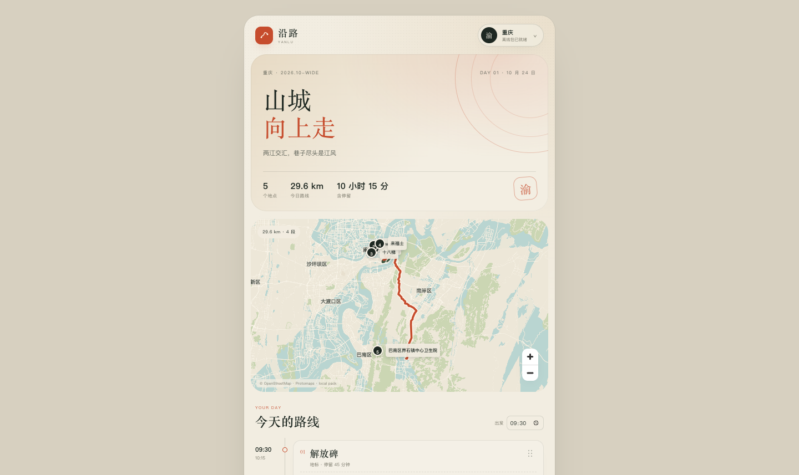

# M2.2b · 离线 POI 搜索

- 日期：2026-10-24
- 状态：Web 验证通过；Android APK 已构建，模拟器/真机安装待验证
- 目标：不依赖地图上是否显示某个标注，直接搜索全城 OSM 地点并加进行程。

## 索引

从现有 OSM PBF 提取的 landmarks 生成紧凑索引：

```text
app/public/poi/chongqing.json  16082 条  1.9 MB
app/public/poi/wuhan.json       6575 条  0.8 MB
app/public/poi/guiyang.json     1762 条  0.2 MB
```

字段：

```json
{"name":"洪崖洞","kind":"tourism","kindValue":"attraction","lon":106.58,"lat":29.56}
```

索引随 App 打包，搜索完全离线；不依赖地图包是否覆盖该建筑。

## 搜索

`AddPlaceSheet` 增加离线搜索：

- 输入“医院”“商场”“洪崖洞”等关键词
- 从 1.6 万条重庆地点中筛选
- 过滤公交站台/站牌节点
- 同名地点去重
- 点击结果直接加入当天行程，路线/时间自动重算
- 没有结果时显示空状态

## 验证

- 搜索“医院”得到“巴南区界石镇中心卫生院”“拜博口腔医院”“蔡家医院”等
- 点击“巴南区界石镇中心卫生院”，行程从 4 个点变为 5 个点
- 路线从 6.9 km 变为 29.6 km / 4 段，说明新地点参与算路
- 搜索索引在断网下可用（App 内置）




## 限制

- 目前只有重庆主城索引覆盖较全；武汉/贵阳索引基于现有 OSM 提取范围
- 搜索是简单子串匹配 + 名称排序，还没有拼音、别名、分类权重
- 还没做地图点选：下一版可以直接在地图上点一个 POI 加入
- 同名不同分店会被去重，只保留一个结果
- Android 这版还没安装验证
- APK 因 POI 索引增至约 1.0 MB
