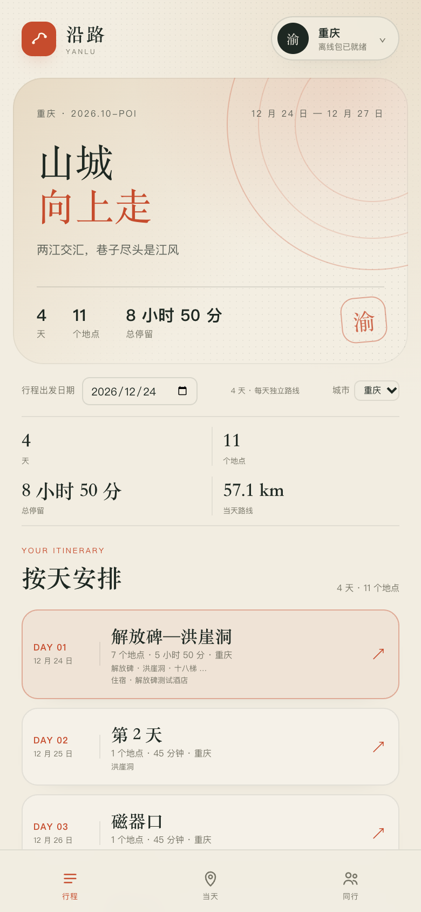
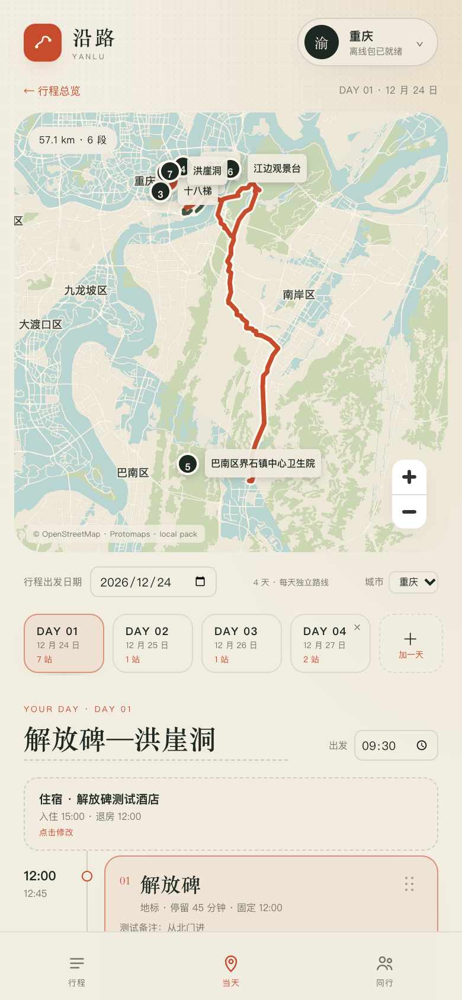
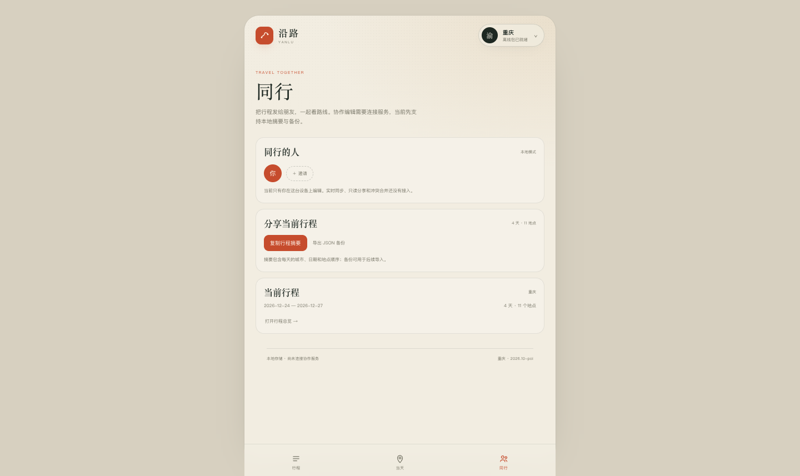

# UI · 三页结构

- 日期：2026-10-26
- 状态：Web 已验证；Android APK 已构建，真机待验证

## 页面

把原来的单页滚动拆成三页，对应底部导航：

1. **行程**：旅行总览
   - Hero：城市、日期范围、天数/地点/总停留
   - 出发日期、每天城市
   - 多日总览
   - 每天一张卡片：标题、日期、城市、地点数、停留、前 3 个地点、住宿
   - 点卡片进入当天
   - 再加一天

2. **当天**：地图 + 当天编辑
   - 顶部返回总览
   - 大地图（当前天城市、路线、点选）
   - 日期/城市/复制前一天
   - Day 切换
   - 当天标题、出发时间、住宿
   - 时间轴、拖拽排序、固定时间、备注、添加地点

3. **同行**：协作与分享
   - 同行人（当前本地模式，未接协作后端）
   - 复制行程摘要
   - 导出 JSON 备份
   - 当前行程信息
   - 明确说明实时同步/只读分享/冲突合并尚未接入

## 对应关系

`index.html` 的三屏是：总览 / 当天与地图 / 拖动状态。

本版：

- 总览 → 「行程」页
- 当天与地图 → 「当天」页
- 拖动状态 → 保留在「当天」页的实时重排，不单独占一页
- 底部第三项用「同行」承接原型的协作入口

## 验证

- 底部三页切换正常，当前页高亮
- 行程页显示 4 天、11 个地点，卡片可进入对应天
- 点击 DAY 01 进入当天页，地图、7 个地点、住宿、固定时间均保留
- 当天页仍可打开添加地点、地点编辑、复制到另一天、住宿编辑
- 同行页可复制摘要/导出 JSON，按钮有明确反馈
- 390 × 844 移动端截图检查通过
- 总览统计在窄屏改为 2×2，不再折行
- 第一次进「当天」后，切回总览再回来，地图实例保留、不重新加载
- 总览停留约 0.8 秒后，在隐藏的当天页预加载地图；如果用户稍后再进入，通常无需等待
- 页面切换有轻量淡入位移动画

## 截图

## 后续优化

- 如果进入「当天」过快，首次仍可能看到短暂加载提示
- 同行页接真实协作后端
- 拖动排序的路线预览动画可以继续加强
