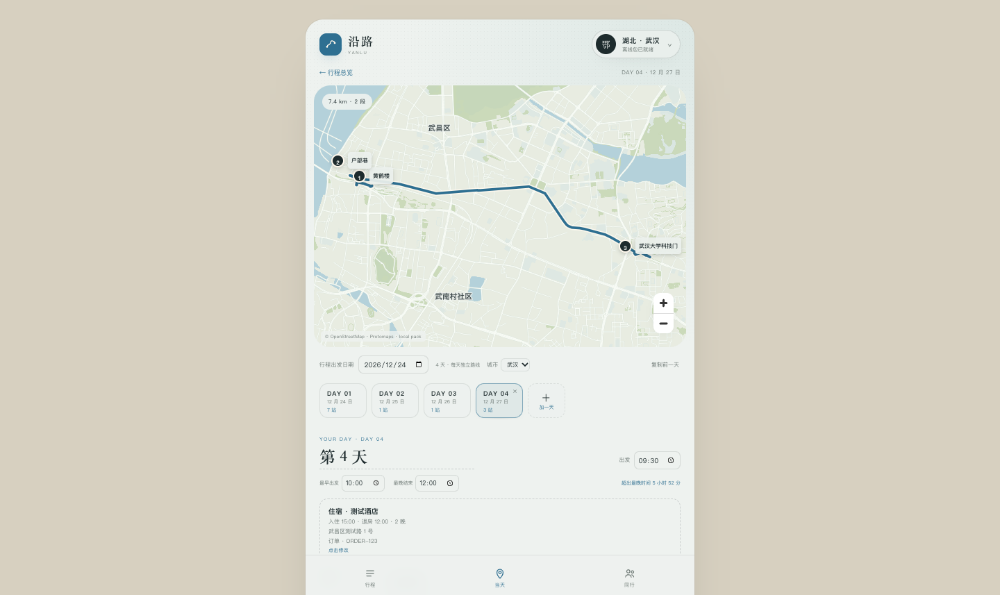

# M2.5 · 交通与住宿完整化

- 日期：2026-10-26
- 状态：Web 逐项测试 + 整体回归通过；Android APK 已构建，真机待验证

## 数据模型

### 交通班次

`Stop.transportInfo`：

```ts
{
  kind: 'flight' | 'train' | 'bus' | 'ferry' | 'other';
  number: string;
  from: string;
  to: string;
  departTime: string;
  arriveTime: string;
  preArriveMin: number;
}
```

- 先把车站/机场作为地点加入（搜索或地图点选）
- 在地点编辑面板点“设为交通班次”
- 填班次、出发/到达站、发车/到达时间、提前到站

### 住宿

`Day.lodging`：

```ts
{
  name: string;
  checkIn: string;
  checkOut: string;
  nights?: number;
  address?: string;
  booking?: string;
  lon?: number;
  lat?: number;
  note?: string;
}
```

住宿不参与步行/打车算路，只进入当天信息与总览。

### 每日时间约束

`Day.earliestStart` / `Day.latestEnd`：

- 最早出发：时间轴起点不会早于该时间
- 最晚结束：最后一段超过时显示红色提示

## 时间轴规则

- 普通地点：`arrive = max(上一步结束, 固定到达时间)`
- 交通班次：`到站 = 发车 - 提前到站`；`离开 = 到达时间`
- 跨夜班次：到达时间早于发车时自动按次日处理
- 固定时间地点仍会等待，后续顺延

## 验证

- 把“黄鹤楼”设为交通班次：`G1234 重庆北 → 武汉 10:00–14:00`
- 时间轴首站 09:30（10:00 - 30 分钟提前到站），离开 14:00，下一站 14:10
- 设置最早出发 10:00、最晚结束 12:00：
  - 首站变为 10:00
  - 显示“超出最晚时间 5 小时 52 分”
- 住宿“测试酒店”：
  - 入住 15:00 / 退房 12:00 / 2 晚
  - 地址、订单号、经纬度保存
  - 刷新后仍显示
- DAY 01 固定 12:00 仍生效，首站 12:00
- 三页切换、逐日算路、全行程 64.5 km 均正常



## 限制

- 交通班次仍依附在一个地点上；还没有独立的“纯交通段”条目
- 不支持多段中转/联程
- 不支持实时班次查询或晚点
- 住宿坐标目前手填，尚未接“地图选点”
- 跨时区不处理

## 下一步

M3.0 局域网传输 spike：两台 Android 真机，同一 Wi-Fi，原生本地服务 + 一条消息广播。
