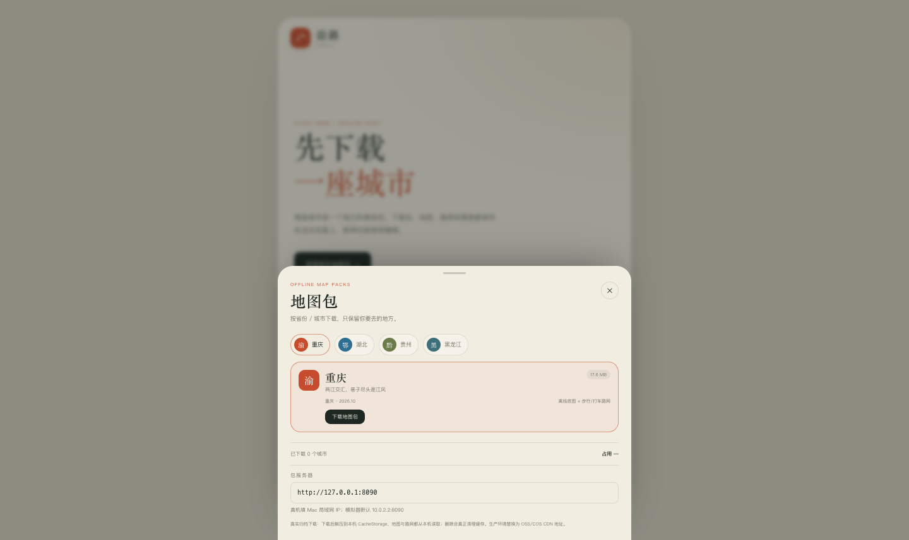

# 真机下载卡在 1% 的排查

## 结论

**不需要科学上网。** 当前地图包由 Mac 上的本地 `pack_server.py` 提供，不是公网服务。

真机 APK 如果仍使用模拟器默认地址 `http://10.0.2.2:8090`，手机会一直等这个不可达地址，进度停在 1%。新版已加：

- 地图包底部可编辑“包服务器”地址
- 下载 15 秒超时，失败会显示具体原因
- 默认 APK 已按当前 Mac 局域网 IP 构建；IP 变化时在 App 里改

## 正确用法

1. 在 Mac 上查当前局域网 IP：

```bash
ipconfig getifaddr en0
# 例如 192.168.10.234
```

2. 启动包服务器：

```bash
cd app
python3 scripts/pack_server.py --port 8090
```

3. 手机和 Mac 连同一个 Wi-Fi / 热点，关闭手机 VPN（VPN 可能拦截局域网）。

4. 先用手机浏览器测试：

```text
http://<Mac-IP>:8090/packs/chongqing.yanlu-pack.zip
```

能开始下载/显示文件，说明网络通。

5. 打开 App → 右上角城市 → 地图包 → 底部“包服务器”填：

```text
http://<Mac-IP>:8090
```

再点“下载地图包”。

## 如果还是不通

- macOS 防火墙：系统设置 → 网络 → 防火墙，允许 Python 接收传入连接。
- 路由器/热点开启了 AP 隔离：手机和 Mac 不能互访；换一个网络或关闭隔离。
- 公司 Wi-Fi 常有限制；改用手机热点或 USB。
- USB 调试可用时，可用 adb 反向端口，不依赖 Wi-Fi：

```bash
adb reverse tcp:8090 tcp:8090
# App 包服务器填 http://127.0.0.1:8090
```

- 确认 `pack_server.py` 监听 `0.0.0.0:8090`，不是只监听 `127.0.0.1`。

## 新版行为

错误示例：

```text
下载失败：连接包服务器超时：http://10.0.2.2:8090。
真机请填写 Mac 的局域网 IP，例如 http://192.168.1.10:8090
```

不会再无限停在 1%。


