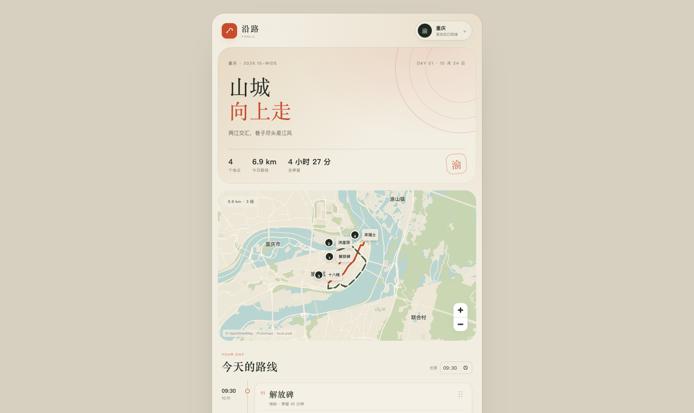
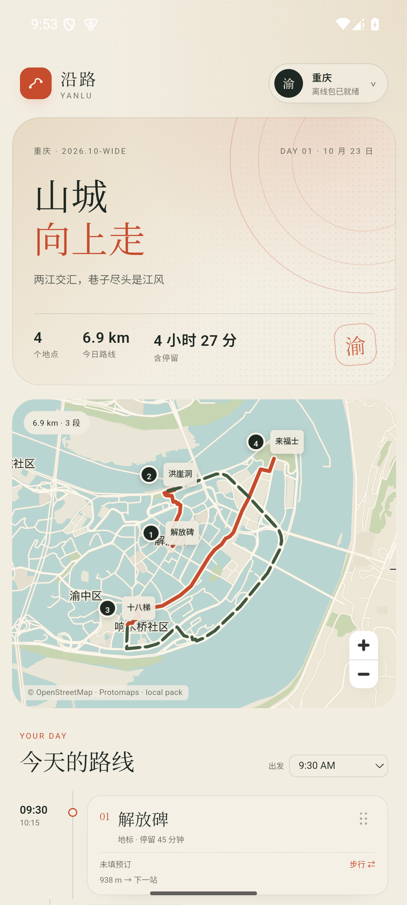

# M2.3b · 重庆主城全区覆盖

- 日期：2026-10-24
- 状态：Web + Android 35 arm64 模拟器验证通过
- 目标：把重庆标准包从“核心区”扩到“主城全区”，看体积和标注密度。

## 覆盖范围

旧核心区：

```text
106.42,29.49 – 106.65,29.63
```

新主城全区：

```text
106.20,29.30 – 106.85,30.05
```

覆盖渝中、江北、南岸、九龙坡、沙坪坝、大渡口、渝北、北碚、巴南等主城区域；**不是整个重庆市**，万州、涪陵、黔江等远郊区县仍不在包内。

## 数据变化

| 项目 | 旧核心区 | 主城全区 |
|---|---:|---:|
| 瓦片数 | 481 | 6407 |
| 底图瓦片 | 6.36 MB | 23.58 MB |
| 步行图 | 6.6 MB | 29.5 MB |
| 打车图 | 4.6 MB | 25.4 MB |
| 解压后 | 17.6 MB | **78.5 MB** |
| zip | 9.7 MB | **39 MB** |

路网从 `spikes/data/chongqing-wide-walk/car.json` 生成；标注仍来自 Protomaps/OSM 瓦片。

## 结果

- 标准重庆包现在是主城全区 z15
- 核心区精细包仍是 z16，只覆盖核心区
- 标注图层增加了 `macrohood`，低缩放能看到更多片区名
- 核心区外的道路、河流、建筑、地点开始出现
- 包体积从 17.6 MB 涨到 78.5 MB，zip 39 MB



## 缓存迁移

因为覆盖范围和归档都变了，缓存命名空间从：

```text
yanlu-pack-<city>
```

升级为：

```text
yanlu-pack-v2-<city>
```

旧缓存会在启动时清理，用户需要重新下载重庆包。

## Android 验证

- 安装 637 KB APK，首启下载 39 MB 主城全区包
- 缓存命名空间 `yanlu-pack-v2-chongqing`
- 地图、标注、6.9 km / 3 段路线正常



## 限制

- 仍不是重庆全市；远郊区县没有数据
- 仍是 z15；核心区外没有 z16 精细瓦片
- 标注密度仍受 OSM 数据和过滤规则影响，低缩放不会显示所有村庄/POI
- 39 MB 的 zip 对移动网络偏大，后续需要 Wi-Fi 提示/断点续传/CDN

## 下一步

1. 决定是否继续扩到重庆全市
2. 核心区外是否也需要 z16
3. 接 CDN + 断点续传 + 包版本更新
4. 离线 POI 搜索，减少对底图标注密度的依赖
