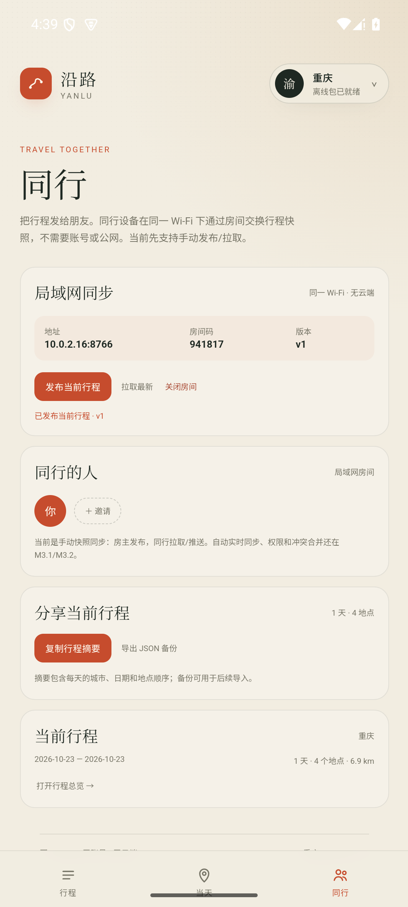

# M3.0 · 局域网传输 spike

- 日期：2026-10-26
- 状态：原生 Host + 浏览器 Guest 验证通过；同一 Wi-Fi 的两台 Android 真机待验证
- 约束：无账号、无云端、无公网服务器；同一 Wi-Fi，房主 App 保持打开

## 架构

```text
Android 房主 App
├── WebView UI
├── MainActivity.LanBridge
│     ├── start()
│     ├── stop()
│     ├── info()
│     └── publish(tripJson)
└── LanSyncServer : 0.0.0.0:8766
      ├── GET  /info
      ├── GET  /snapshot?room=XXXXXX
      └── POST /snapshot?room=XXXXXX
```

同行设备可以是：

- 另一台 Android App
- 同一 Wi-Fi 下的浏览器（用于测试/兜底）

## 协议

- 房主启动时生成 6 位房间码
- `GET /info` 返回 IP、端口、房间码、版本
- `GET /snapshot` 返回最近一次发布的行程 JSON
- `POST /snapshot` 更新行程并递增版本
- 房间码作为最低限度的房间隔离
- 快照是整个 Trip JSON，最后写入者覆盖
- CORS 允许局域网内页面；仅用于近场协作

## 已验证

1. 模拟器内启动房间：`10.0.2.16:8766`，房间码 `196942/266455`
2. 原生 `publish` 发布当前行程，版本 v1
3. `GET /snapshot` 返回完整 Trip
4. 浏览器 Guest 通过 `127.0.0.1:8766`（adb forward）加入
5. Guest 推送本机行程，房主拉取版本递增（CORS preflight 200，中文字段保留）
6. `OPTIONS` preflight 200，`POST` 中文字段完整保留

## 未完成

- 两台 Android 真机同 Wi-Fi 的最终验收
- 自动实时同步（现在是手动发布/拉取）
- 成员列表、权限、房间密码之外的身份
- 冲突合并：当前整份 Trip 最后写入者覆盖
- 二维码发现、mDNS/NSD
- 传输加密：局域网内仅房间码隔离，不能当公网安全方案
- 房主后台存活/前台服务

## 截图



## 下一步

M3.1：成员加入/离开、房间生命周期、自动拉取（1–2 秒轮询）与最后修改提示。
