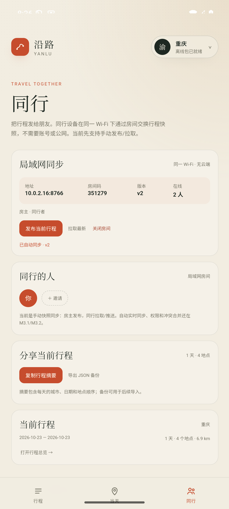

# M3.1 · 房间自动同步与在线成员

- 日期：2026-10-27
- 状态：房主 Android + 浏览器 Guest 自动同步验证通过；两台 Android 真机待验证

## 自动同步

- 房主本地编辑后自动发布（900 ms 防抖）
- Guest 本地编辑后自动推送
- 双方每 1.5 秒轮询快照
- 版本号只增；版本不大于本地已应用版本时忽略
- 应用远端快照时先更新 `lanJsonRef`，避免回写产生回声
- 状态行显示“自动同步 · vN”

## 在线成员

- 房主服务新增：
  - `POST /hello?room=&id=&name=`
  - `GET /members?room=`
- 在线状态 12 秒过期
- App 每 3 秒 ping 一次
- 同行页显示在线人数与名字

## 已验证

1. 房主开启房间，自动发布当前行程 v1
2. 浏览器 Guest 加入，显示 `在线 2 人 / 房主 · 同行者`
3. Guest 修改当天标题 → 房主自动收到，版本递增
4. 房主修改标题 → Guest 自动更新
5. 自动同步不影响手动发布/拉取按钮
6. CORS、中文 POST、成员列表均正常

## 代码审查修复

- `/info` 现在必须带正确房间码，未带返回 403；此前会直接把房间码泄露给同网段设备
- 新开房间会清空旧快照、版本号和成员，避免新一轮房间继承上一轮数据
- `POST /snapshot` 限制 2 MB，超限返回 413
- 请求体改为批量读取，避免整份 Trip 逐字节读
- 成员过期使用 `removeIf`，不再依赖迭代器删除
- 手动拉取会同步更新本地版本/JSON，避免下一轮轮询重复应用
- 轮询增加 in-flight 防重入，避免慢请求堆积
- `/members`、`/snapshot` 都要求房间码

## 限制

- 整份 Trip 快照，最后写入者覆盖；没有字段级冲突合并
- 自动同步依赖双方 App/页面保持前台
- 在线成员只按 12 秒 TTL，没有显式离开广播
- 没有传输加密，只有房间码隔离
- 两台 Android 真机同 Wi-Fi 还未实测
- 浏览器 Guest 可用；浏览器不能当房主

## 下一步

M3.2：显式加入/离开、最后修改人/时间、字段级冲突提示；不引入账号或云端。
