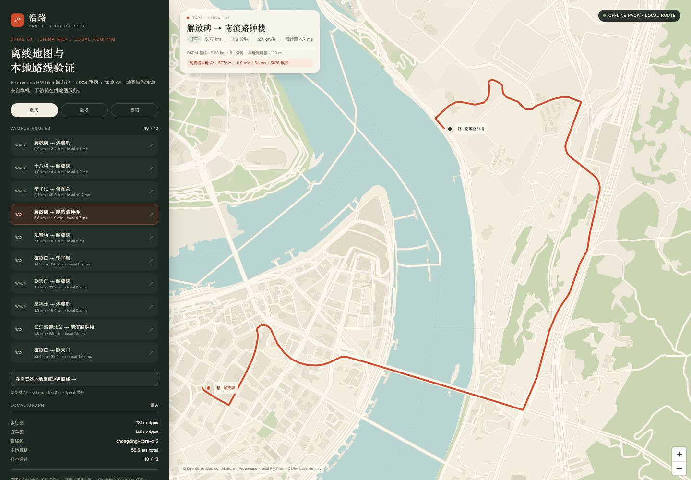
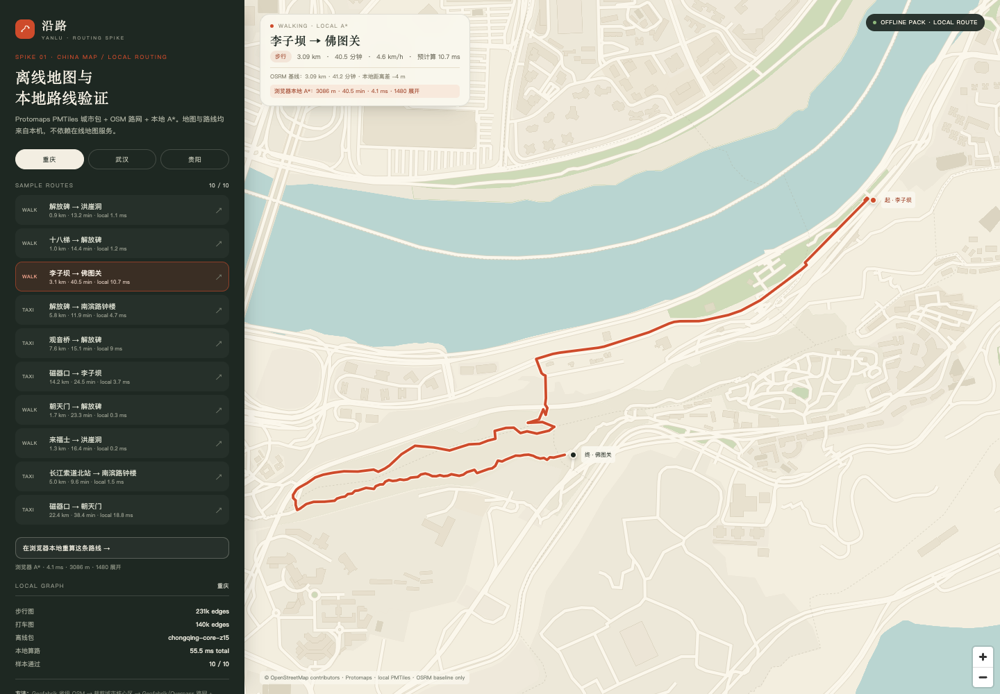
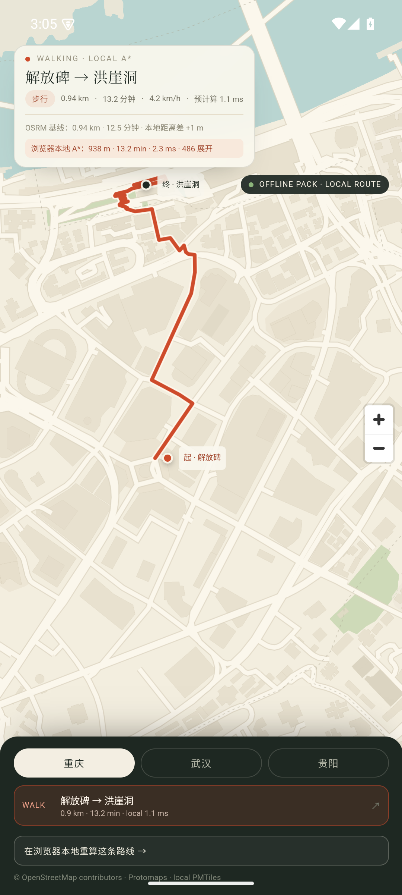
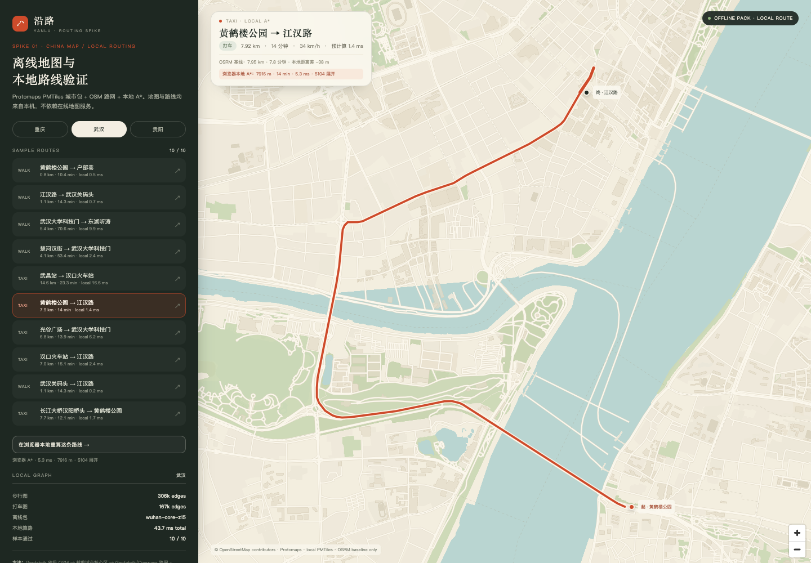
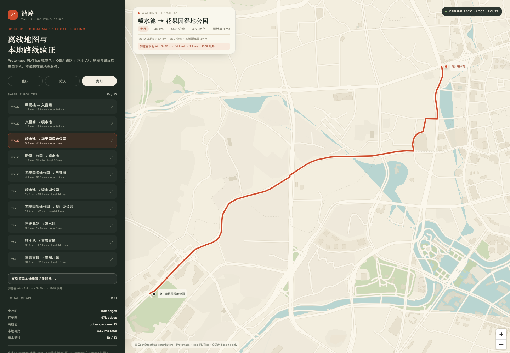

# 三城离线地图与本地路由 · 第一轮验证报告

- 日期：2026-10-22
- 对应计划：[docs/SPIKE-CITIES.md](../SPIKE-CITIES.md)
- 状态：**条件通过**。开源栈 A 可以继续，但路线质量、出租车时长和离线标签仍需修正。
- 结论先说：重庆 / 武汉 / 贵阳三城 30 条样本全部能算出路线；28/30 与 OSRM 基线距离误差 ≤10%，29/30 ≤20%。城市包 + 两张路网图合计约 10–21 MB/城，离线地图和浏览器内 A* 均已跑通。



---

## 1. 这轮验证了什么

1. 从 Geofabrik 省级 OSM PBF 裁剪出三城核心区，生成 **Protomaps PMTiles 离线底图**。
2. 从同一批 OSM 数据构建 **步行图 / 打车图**，只保留最大连通分量。
3. 用 **本地 A***（Node + 浏览器内各一份）计算 30 条样本路线。
4. 用 OSRM 公共实例做**开发期对照**（不进入 App）。
5. 在本地 PMTiles/ZXY 服务上加载 MapLibre，预览路线；断外网仍可加载和重算。
6. 生成静态 CDN 用的 pack manifest，并验证 HTTP Range/CORS 与 SHA-256。

没有验证：真实 Android WebView 性能、Kotlin 本地服务、离线中文标签、离线 POI 搜索、转向限制/坡度。

---

## 2. 数据与包体积

| 城市 | bbox（核心区） | PBF | 高速路 way | 命名 POI | 步行图 nodes / edges | 打车图 nodes / edges | PMTiles | 两张图 |
|---|---|---:|---:|---:|---:|---:|---:|---:|
| 重庆 | 106.42–106.65E, 29.49–29.63N | 31.3 MB | 20,218 | 11,159 | 105,522 / 230,544 | 91,676 / 140,224 | 6.36 MB | 11.27 MB |
| 武汉 | 114.22–114.45E, 30.47–30.65N | 56.0 MB | 26,353 | 13,201 | 137,222 / 305,880 | 97,011 / 167,408 | 7.25 MB | 13.96 MB |
| 贵阳 | 106.55–106.76E, 26.30–26.66N | 29.0 MB | 9,595 | 4,813 | 53,079 / 113,296 | 60,297 / 96,529 | 3.65 MB | 6.47 MB |

说明：

- 城市只覆盖核心区，不是整个行政区；重庆尤其重要。
- 路网图只保留最大弱连通分量，避免孤立节点导致“有图但走不到”。
- 数据源：Geofabrik `china/chongqing`、`china/hubei`、`china/guizhou` 的 2026-10-20 省级 PBF；底图瓦片来自 Protomaps Basemap（z0–15）。
- 单城总包 **10–21 MB**，远低于 200 MB 目标。这个数字只包含底图 + 两张图；生产还要加 POI 索引和本地 glyphs/sprites。

---

## 3. 路线质量

### 3.1 与 OSRM 基线对比

| 城市 | 样本 | 成功 | ≤10% 误差 | ≤20% 误差 | 平均绝对误差 | 最大误差 |
|---|---:|---:|---:|---:|---:|---:|
| 重庆 | 10（5 步行 / 5 打车） | 10 | 9 | 9 | 4.4% | 21.9% |
| 武汉 | 10（5 步行 / 5 打车） | 10 | 9 | 10 | 2.5% | 12.1% |
| 贵阳 | 10（5 步行 / 5 打车） | 10 | 10 | 10 | 2.5% | 9.4% |

- **28/30 ≤10%，29/30 ≤20%**。整体说明 OSM 路网 + A* 的方向是对的。
- 误差是“与 OSRM 的路线距离差”，不是与真实世界的绝对误差；OSRM 也可能有数据/转向差异。
- 人工视觉只抽查了 7 条代表性路线（三城跨江/山地/长距离）；其余 23 条目前只有 OSRM 距离对照，**正式验收仍需逐条看几何和道路合法性**。
- 完整逐条数据：[`spikes/out/all-routes.csv`](../../spikes/out/all-routes.csv)。

### 3.2 需要人工确认的异常

| 样本 | 本地 | OSRM | 差值 | 初判 |
|---|---:|---:|---:|---|
| 重庆 `cq-walk-08` 来福士 → 洪崖洞 | 1,257 m / 16.4 min | 1,610 m / 21.5 min | **−21.9%** | 本地走了更短的步行连接；需要确认是否穿小区/楼梯，还是 OSRM 绕路 |
| 武汉 `wh-taxi-07` 光谷广场 → 武汉大学科技门 | 6,833 m / 13.9 min | 6,093 m / 10.8 min | **+12.1%** | 本地绕向东湖一侧，疑似打车图缺少一条连接/转向限制 |
| 重庆 `cq-taxi-10` 磁器口 → 朝天门 | 22,401 m / 38.4 min | 21,051 m / 22.6 min | +6.4% | 距离接近；**时长明显保守**，打车速度需要标定 |
| 贵阳 `gy-taxi-06` 喷水池 → 观山湖公园 | 13,203 m / 18.7 min | 14,566 m / 14.0 min | −9.4% | 距离偏短；需核对出入口/隧道/快速路 |

另外：

- **重庆李子坝 → 佛图关** 本地 3.09 km、OSRM 3.09 km，本地 40.5 min、OSRM 41.2 min。两条独立路线都选择绕行，说明“看起来近、实际要绕山/铁路”是真实约束，不是算法独有。
- **出租车时长整体偏保守**：本地按道路等级估算，不含实时路况，普遍比 OSRM 慢 10%–40%（长距离更明显）。v1 必须标注“估算”，并在产品里校准城市平均速度。
- **转向限制尚未建模**：目前只处理 `oneway`、`access`；没有 turn restriction、路口禁左等。重庆/武汉立交多，这会放大误差。
- **没有坡度/楼梯权重**：重庆、贵阳的步行时间会被低估或高估；v1 至少要在 UI 里提示“坡道/楼梯多”。

---

## 4. 性能

- Node 全量 10 条路线：重庆 55.5 ms、武汉 43.7 ms、贵阳 44.7 ms（含读图和输出）；单条最大 18.8 ms。
- 浏览器内实际 A*（选择路线后点击“在浏览器本地重算”）：
  - 重庆解放碑 → 南滨路：**6.1 ms**
  - 重庆李子坝 → 佛图关：**4.1 ms**（断外网复测）
  - 武汉黄鹤楼 → 江汉路：**5.3 ms**
  - 贵阳喷水池 → 花果园：**2.8 ms**
- 路网图大小 3.0–8.3 MB/张；本机加载通常 <1 s。**移动端 WebView 上的解析和内存占用仍未测**，这是下一轮必须验证的。
- headless Chrome 需要 SwiftShader 才能稳定渲染 MapLibre；真机 WebView 另测。

---

## 5. 离线与分发

### 5.1 离线验证

用 Chrome 的 host resolver 规则阻断外部 DNS，只放行 `127.0.0.1` / `localhost`：

- MapLibre、底图 PMTiles、路线 GeoJSON、路网图全部来自本地；
- 浏览器内 A* 仍算出 `3,086 m / 40.5 min / 4.1 ms`；
- `performance.getEntriesByType("resource")` 中**没有外部资源**；
- 截图：[离线重庆](screenshots/offline-chongqing.png)。



### 5.2 静态 CDN 模拟

- 生成 manifest：[`spikes/web/data/packs.json`](../../spikes/web/data/packs.json)，包含三城 bbox、PMTiles 大小、SHA-256、两张路网图大小。
- 用本地 Range 服务验证：
  - `Range: bytes=0-1023` 返回 **206**、`Content-Range`、`Access-Control-Allow-Origin: *`；
  - 完整下载重庆包后 SHA-256 与 manifest 一致。
- 尚未上传阿里云 OSS / 腾讯云 COS（没有账号凭据）；本轮只验证了客户端需要的 HTTP 语义与哈希校验。


---

## 6. Android 壳验证（模拟器）

> 结论：**功能链路在 Android 上跑通**；但当前只连了 Android 35 arm64 模拟器，尚未连接物理真机，不能把这一节当作真机验收。

- 工具链：Temurin JDK 21、Android SDK platform 35 / build-tools 35.0.0；手工 `aapt2 → javac → d8 → zipalign → apksigner` 构建，绕开本机 Gradle native 兼容问题。
- APK：`com.yanlu.travel`，minSdk 26，targetSdk 35，约 **26 MB**；三城 assets 约 53 MB。
- 设备：`sdk_gphone64_arm64`，Android 35，1080×2400，dpr 2.625。
- 结果：
  - 冷启动 `am start -W`：**971 ms**；本地服务启动后 **0.38 s** 页面完成。
  - 三城底图、路线列表、起终点 marker、路线 fitBounds 均正常。
  - 浏览器 A*：重庆 2.3 ms、武汉 0.8 ms、贵阳 1.2 ms。
  - 飞行模式 + 关闭 Wi-Fi/数据后强制停止再启动：地图和 A* 仍正常，无外部网络。
  - 内存：TOTAL PSS **126.6 MB**，TOTAL RSS **239.0 MB**（模拟器，仅参考）。
- 截图：[Android 重庆](screenshots/android-chongqing.png)、[Android 武汉·飞行模式](screenshots/android-wuhan-offline.png)、[Android 贵阳](screenshots/android-guiyang.png)。



### 还没完成的真机项

- 物理 Android 手机安装、USB 调试授权、真实 GPU/WebView 性能
- 低端机内存/发热/首屏时间
- 状态栏/刘海/横屏适配
- 真机上的手势拖动排序（当前只验证地图与算路）

---

## 7. 截图

| 重庆·跨江打车 | 武汉·跨江打车 | 贵阳·步行 |
|---|---|---|
|  |  |  |

> 底图暂未包含中文道路/POI 标签：本轮只验证几何、离线加载和算路。生产包必须补本地 glyphs/sprites。

---

## 8. 发现的问题

| 问题 | 影响 | 下一步 |
|---|---|---|
| 无中文标注 | 地图可看但不完整 | 下载并本地化 glyphs/sprites，补主要道路/地名/POI 标签 |
| 无离线 POI 搜索 | 断网只能地图点选 | 打包城市 POI 索引（SQLite FTS / 紧凑二进制）；地图点选作为兜底 |
| 转向限制缺失 | 立交/单行口可能给出不合规路线 | 引入 turn restriction，或改用 GraphHopper/Valhalla 生成的图 |
| 坡度/楼梯未建模 | 重庆/贵阳步行时间不准 | v1 标注“坡度/楼梯影响”；后续加高程/楼梯权重 |
| 打车时长保守 | 长距离时间偏差大 | 按城市/道路等级校准速度；明确无实时路况 |
| 个别 snap >100 m | 起点/终点偏到辅路/对街 | 改进入口 POI 吸附、最近可通行边吸附 |
| 贵阳北站 snap 220 m | 站点接驳路线可能偏 | 补站前道路/出入口；支持手动拖点 |
| 本地服务仍是 Go CLI + Python | 不是 APK 内方案 | Kotlin 本地 HTTP 服务插件，服务 PMTiles 与同步 |
| WebView 未实测 | 手机性能未知 | 下一轮做 Capacitor + Android WebView proof |
| OSRM 公共实例仅作对照 | 不能作为生产依赖 | 生产使用本地 A*；如需更强质量，接 Valhalla/GraphHopper 自建 |

---

## 9. 决策

**条件通过：继续走开源栈 A，不切换到国内 SDK。**

理由：

- 三城 30/30 能算出路线，28/30 距离误差 ≤10%；
- 单城 10–21 MB，离线地图 + 本地 A* 可行；
- 浏览器内 A* 4–6 ms，跨端复用路径成立；
- 断外网验证通过，不依赖在线地图服务。

但必须先解决：

1. 异常路线（至少 `cq-walk-08`、`wh-taxi-07`、`gy-taxi-06`）的人工复核与图修正；
2. 出租车时长标定 + “估算”标识；
3. 本地 glyphs/sprites 与离线 POI；
4. 转向限制/坡度；
5. Android WebView + Kotlin 本地服务真机验证。

---

## 10. 复现

```bash
# 1. 依赖
python3 -m venv .venv-spike
.venv-spike/bin/pip install osmium mapbox-vector-tile

# 2. PMTiles CLI
curl -L -o /tmp/pmtiles.zip \
  https://github.com/protomaps/go-pmtiles/releases/download/v1.31.2/go-pmtiles-1.31.2_Darwin_arm64.zip
unzip -o /tmp/pmtiles.zip -d tools && chmod +x tools/pmtiles

# 3. 省级 PBF（示例：重庆；武汉/贵阳见 spikes/cities.json）
curl -L -A "yanlu-spike/0.1" -o spikes/data/osm/chongqing-latest.osm.pbf \
  https://download.geofabrik.de/asia/china/chongqing-latest.osm.pbf

# 4. 裁剪 + 建图 + 算路
.venv-spike/bin/python spikes/scripts/extract_city.py chongqing
.venv-spike/bin/python spikes/scripts/build_graph.py chongqing
node spikes/routing/astar.ts chongqing

# 5. 底图城市包
tools/pmtiles extract https://build.protomaps.com/20261021.pmtiles \
  spikes/map/chongqing-core-z15.pmtiles \
  --bbox=106.42,29.49,106.65,29.63 --maxzoom=15

# 6. 浏览器预览
mkdir -p spikes/web/data/graphs
cp spikes/data/chongqing-walk.json spikes/data/chongqing-car.json spikes/web/data/graphs/
.venv-spike/bin/python spikes/scripts/combine_web_data.py
.venv-spike/bin/python spikes/scripts/make_manifest.py
tools/pmtiles serve spikes/map --port=8090 --cors='*' &
python3 -m http.server 8091 --directory spikes/web &
# http://127.0.0.1:8091/preview.html?city=chongqing&route=cq-walk-03&recompute=1
```

生成数据、PMTiles、PBF、路网图均不进 Git；只提交脚本、配置、路线摘要/GeoJSON、manifest、截图与本报告。详见 [`spikes/README.md`](../../spikes/README.md)。
